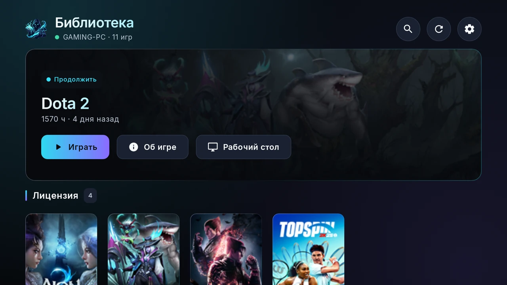
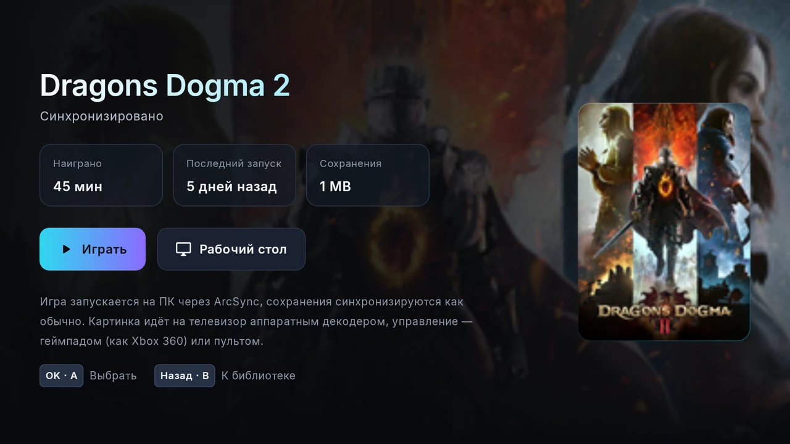
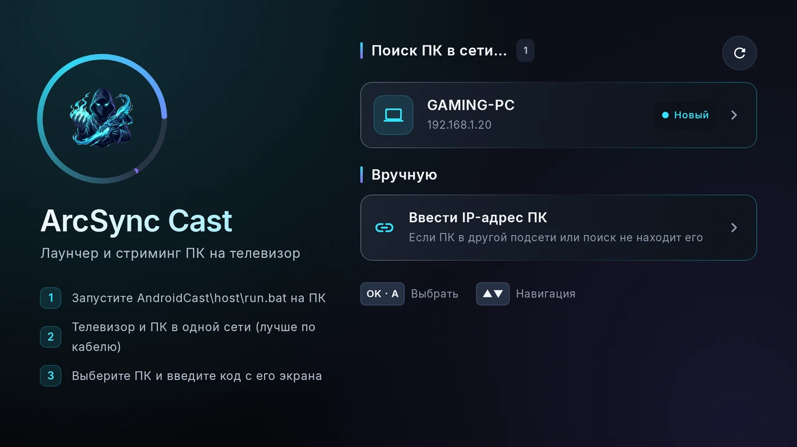
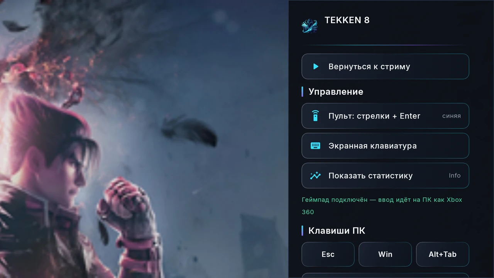

# ArcSync Cast TV

**Your PC games. On the big screen.**

[Download APK](../../releases/latest) · [ArcSync for Windows](https://github.com/Rezerv-EM/ArcSync) · [Release history](CHANGELOG.md) · [Русский](README.ru.md)

An add-on for [ArcSync](https://github.com/Rezerv-EM/ArcSync) made for Android TV: browse your ArcSync library with the TV remote, launch a game on the PC and play it on the TV with a gamepad. Built for weak TV chips: a light interface, hardware decoding and a remote-friendly layout.

**Alpha 0.1 · Android TV 6+ · Requires ArcSync 0.1.5+ on Windows · Russian interface**



## Features

- The ArcSync library on the TV: covers, playtime, last played and save status, made for the remote (arrows + OK).
- **Play** starts the game on the PC through ArcSync; saves sync as usual.
- Hardware decoding; frame rate and bitrate tuned to what the TV decoder really handles.
- Gamepad connected to the TV becomes an Xbox 360 controller on the PC; the remote works as arrows/Enter or as a mouse.
- PC keys (Esc, Win, Alt+Tab) and an on-screen keyboard during the stream.
- Finds the PC on the network, wakes it with Wake-on-LAN, pairs once with a 6-digit code.

## Interface

### Game details



### Find your PC



### Stream menu



## Install

1. Install or update [ArcSync](https://github.com/Rezerv-EM/ArcSync/releases/latest) **0.1.5 or newer** on the PC.
2. Download **ArcSyncCastTV-0.1-alpha.apk** from the [latest release](../../releases/latest) and check its SHA-256 with `SHA256SUMS.txt`.
3. Install it on the TV: copy the APK to a USB stick and open it with a file manager, or use `adb install`.
4. TV and PC on the same network (Ethernet is best). Open ArcSync Cast TV, pick your PC and enter the code shown on the PC.

```text
certutil -hashfile ArcSyncCastTV-0.1-alpha.apk SHA256
```

## Requirements and limitations

- PC: Windows 10/11 with ArcSync 0.1.5+. **The video encoder currently needs an AMD graphics card (AMF).**
- TV: Android TV 6 or newer with a hardware HEVC or H.264 decoder. Tested on Android TV 6/7 televisions.
- Alpha: the APK is signed with a development key. One streaming session at a time (phone, TV or PSP).

## Privacy and security

- No telemetry, advertising or ArcSync account. The app talks only to **your own PC** on your local network.
- Pairing creates a private key on each device; every request is signed. Without pairing the PC answers only to discovery.
- The server on the PC runs **only on demand** and is removed after the session, together with its firewall rule and temporary files.

## Feedback and licensing

This is an **alpha**. Report bugs in [Issues](../../issues): include the app version, device model, Windows version and steps to reproduce.

Free to use as part of [ArcSync](https://github.com/Rezerv-EM/ArcSync) under the [ArcSync EULA](https://github.com/Rezerv-EM/ArcSync/blob/main/EULA.txt). Application source code remains private; this repository contains releases and documentation. See [third-party notices](THIRD_PARTY_NOTICES.md). Game names and images belong to their respective owners. Screenshots show the Russian interface with real library data.

Download: **ArcSyncCastTV-0.1-alpha.apk** from the [latest release](../../releases/latest).
