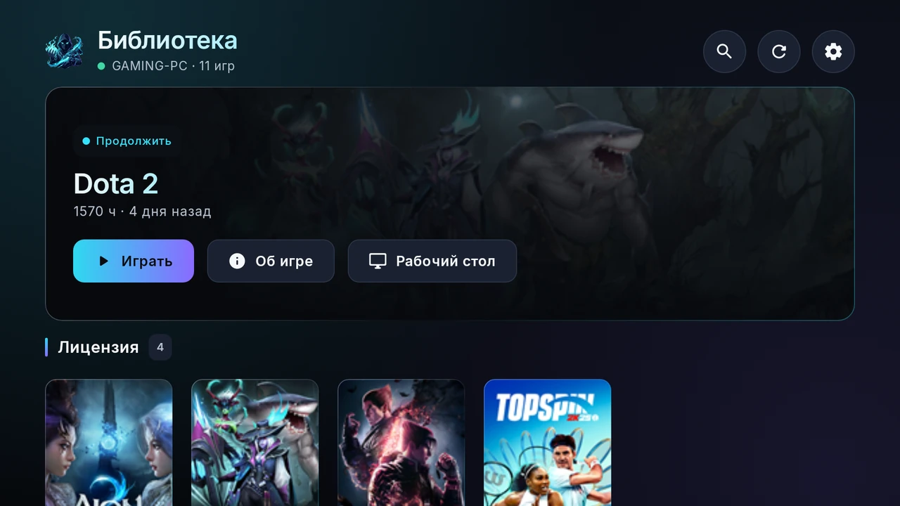
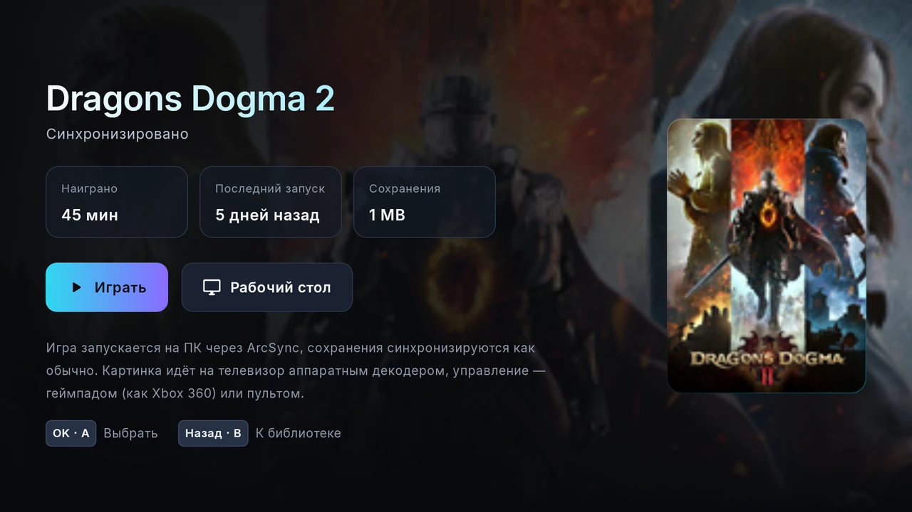
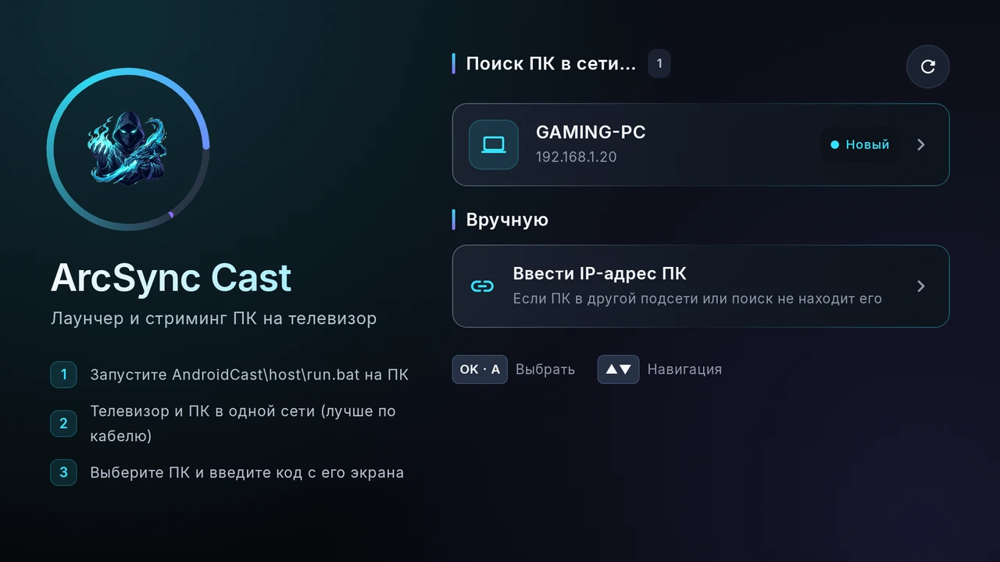
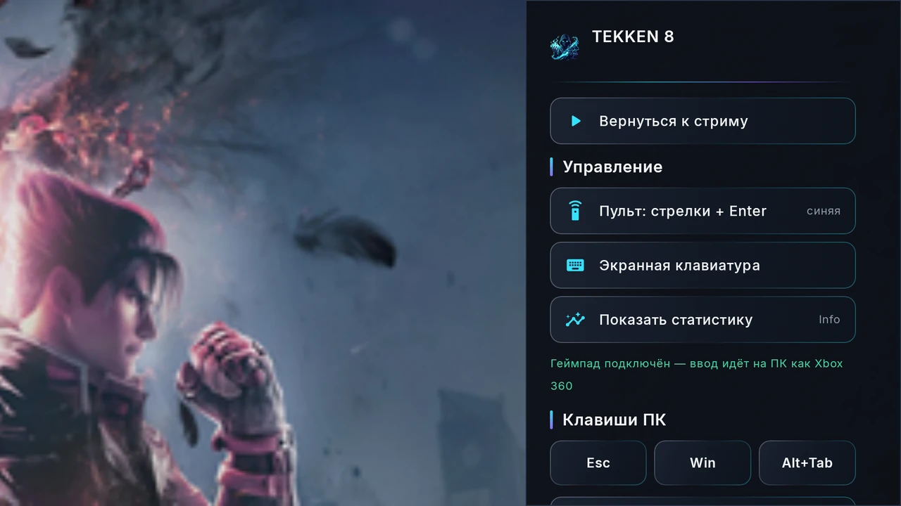

# ArcSync Cast TV

**Игры с ПК. На большом экране.**

[Скачать APK](../../releases/latest) · [ArcSync для Windows](https://github.com/Rezerv-EM/ArcSync) · [История версий](CHANGELOG.md) · [English](README.md)

Дополнение к [ArcSync](https://github.com/Rezerv-EM/ArcSync) для Android TV: листайте библиотеку ArcSync пультом, запускайте игру на ПК и играйте на телевизоре с геймпадом. Сделано для слабых ТВ-процессоров: лёгкий интерфейс, аппаратное декодирование и управление пультом.

**Альфа 0.1 · Android TV 6+ · Нужен ArcSync 0.1.5+ на Windows · Русский интерфейс**



## Возможности

- Библиотека ArcSync на телевизоре: обложки, наигранное время, последний запуск и статус сохранений — всё под пульт (стрелки + OK).
- **Играть** запускает игру на ПК через ArcSync; сохранения синхронизируются как обычно.
- Аппаратное декодирование; частота кадров и битрейт подобраны под реальные возможности декодера ТВ.
- Геймпад, подключённый к ТВ, становится Xbox 360 на ПК; пульт — стрелки/Enter или мышь.
- Клавиши ПК (Esc, Win, Alt+Tab) и экранная клавиатура во время стрима.
- Сам находит ПК в сети, будит его по Wake-on-LAN, сопряжение один раз 6-значным кодом.

## Интерфейс

### Страница игры



### Поиск ПК



### Меню стрима



## Установка

1. Установите или обновите [ArcSync](https://github.com/Rezerv-EM/ArcSync/releases/latest) **0.1.5 или новее** на ПК.
2. Скачайте **ArcSyncCastTV-0.1-alpha.apk** из [последнего релиза](../../releases/latest) и сверьте SHA-256 с `SHA256SUMS.txt`.
3. Установите на телевизор: скопируйте APK на флешку и откройте файловым менеджером или через `adb install`.
4. ТВ и ПК в одной сети (лучше по кабелю). Откройте ArcSync Cast TV, выберите свой ПК и введите код с экрана ПК.

```text
certutil -hashfile ArcSyncCastTV-0.1-alpha.apk SHA256
```

## Требования и ограничения

- ПК: Windows 10/11 и ArcSync 0.1.5+. **Кодировщику видео пока нужна видеокарта AMD (AMF).**
- ТВ: Android TV 6 или новее с аппаратным декодером HEVC или H.264. Проверено на телевизорах с Android TV 6/7.
- Альфа: APK подписан ключом разработки. Один сеанс стрима за раз (телефон, ТВ или PSP).

## Приватность и безопасность

- Без телеметрии, рекламы и аккаунта ArcSync. Приложение общается только с **вашим ПК** в локальной сети.
- При сопряжении на устройстве создаётся свой закрытый ключ, каждый запрос подписан. Без сопряжения ПК отвечает только на поиск.
- Сервер на ПК запускается **только по запросу** и после сеанса удаляется вместе с правилом брандмауэра и временными файлами.

## Обратная связь и лицензия

Это **альфа-версия**. Об ошибках пишите в [Issues](../../issues): версия приложения, модель устройства, версия Windows и шаги, как повторить.

Бесплатно как часть [ArcSync](https://github.com/Rezerv-EM/ArcSync) на условиях [соглашения ArcSync](https://github.com/Rezerv-EM/ArcSync/blob/main/EULA.txt). Исходный код приложения закрыт; в репозитории — релизы и документация. См. [сторонние компоненты](THIRD_PARTY_NOTICES.md). Названия и изображения игр принадлежат их правообладателям. На скриншотах — русский интерфейс и настоящая библиотека.

Скачать: **ArcSyncCastTV-0.1-alpha.apk** в [последнем релизе](../../releases/latest).
